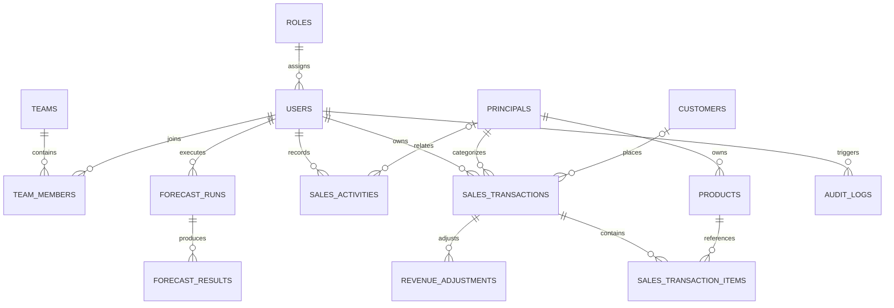

# Database ERD — ADI SalesTrack

## 1. Tujuan

Dokumen ini mendefinisikan model data konseptual untuk mendukung aktivitas sales, transaksi revenue, target, ranking, forecasting, dan audit.

**Catatan:** ERD ini merupakan target desain. Struktur final harus dibandingkan dengan database eksisting sebelum migrasi dilakukan.

## 2. Entitas

### users
Akun pengguna aplikasi.

Kolom inti:
- `id`
- `role_id` atau relasi role sesuai implementasi
- `name`
- `email`
- `password`
- `is_active`
- `created_at`
- `updated_at`

### roles
Daftar role yang tersedia.

Kolom inti:
- `id`
- `code`
- `name`

### principals
Daftar principal/vendor.

Kolom inti:
- `id`
- `code`
- `name`
- `is_active`
- timestamps

### products
Daftar produk yang dimiliki principal.

Kolom inti:
- `id`
- `principal_id`
- `code`
- `name`
- `is_active`
- timestamps

### teams dan team_members
Digunakan jika aplikasi perlu mengatur struktur tim dan histori keanggotaan sales.

Kolom inti:
- `teams`: `id`, `name`, `is_active`
- `team_members`: `team_id`, `user_id`, `effective_from`, `effective_to`

Jika aplikasi hanya memiliki satu tingkat organisasi, model ini tidak perlu dipaksakan.

### sales_activities
Aktivitas yang dilaporkan oleh sales.

Kolom inti:
- `id`
- `user_id`
- `principal_id` nullable jika tidak relevan
- `activity_type`
- `activity_date`
- `summary`
- `outcome`
- `follow_up_date` nullable
- `status`
- `created_at`
- `updated_at`

Kolom approval ditambahkan jika workflow approval digunakan.

### customers
Pelanggan atau prospek jika memang dikelola oleh ADI SalesTrack.

Kolom inti:
- `id`
- `name`
- `status`
- timestamps

### sales_transactions
Transaksi yang menjadi sumber data revenue.

Kolom inti:
- `id`
- `transaction_number`
- `sales_user_id`
- `principal_id`
- `customer_id` nullable
- `transaction_date`
- `revenue_recognition_date` jika diperlukan
- `currency`
- `amount`
- `status`
- timestamps

Definisi `amount` dan tanggal pengakuan harus mengikuti aturan revenue perusahaan.

### sales_transaction_items
Detail transaksi jika satu transaksi dapat berisi beberapa produk.

Kolom inti:
- `id`
- `sales_transaction_id`
- `product_id`
- `quantity`
- `unit_price`
- `subtotal`

### revenue_adjustments
Koreksi terhadap revenue yang dapat ditelusuri.

Kolom inti:
- `id`
- `sales_transaction_id`
- `adjustment_type`
- `amount`
- `reason`
- `status`
- `created_by`
- `approved_by` nullable
- timestamps

Gunakan konvensi tanda positif/negatif yang konsisten untuk koreksi.

### sales_targets
Target berdasarkan periode dan cakupan yang ditentukan.

Kolom inti:
- `id`
- `period_start`
- `period_end`
- `target_amount`
- `currency`
- `scope_type`
- `scope_id` sesuai desain relasi yang dipilih
- `created_by`
- timestamps

Jika diperlukan, gunakan tabel target terpisah atau foreign key nullable untuk menjamin integritas referensial. Hindari `scope_id` polimorfik jika kebutuhan audit dan integritas memerlukan foreign key langsung.

### ranking_snapshots
Opsional, untuk menyimpan hasil ranking yang harus dapat direproduksi.

Kolom inti:
- `id`
- `period_start`
- `period_end`
- `sales_user_id`
- `eligible_revenue`
- `rank_position`
- `calculated_at`

### forecast_runs
Metadata eksekusi Monte Carlo.

Kolom inti:
- `id`
- `created_by`
- `period_start`
- `period_end`
- `cutoff_at`
- `method`
- `simulation_count`
- `parameters`
- `status`
- `started_at`
- `completed_at`

### forecast_results
Hasil simulasi untuk setiap scope dan periode.

Kolom inti:
- `id`
- `forecast_run_id`
- `principal_id` nullable untuk total perusahaan
- `period_start`
- `period_end`
- `expected_revenue`
- `p10`
- `p50`
- `p90`
- `target_amount` nullable
- `target_achievement_probability` nullable
- `quality_warning` nullable

### audit_logs
Jejak aksi penting.

Kolom inti:
- `id`
- `actor_user_id` nullable untuk aksi sistem
- `action`
- `entity_type`
- `entity_id`
- `metadata`
- `created_at`

Jangan menyimpan secret atau token lengkap dalam metadata.

## 3. ERD Konseptual

Relasi target dan ranking tidak digambarkan sebagai foreign key langsung di atas karena cakupan target/ranking dapat berupa perusahaan, tim, sales, atau principal. Implementasi final harus memilih pola relasi yang menjaga integritas referensial.

## 4. Aturan Integritas

- Gunakan foreign key pada relasi yang memiliki referensi langsung.
- Gunakan `DECIMAL` untuk nilai uang.
- Tetapkan unique constraint pada kode master dan nomor transaksi.
- Tentukan strategi soft delete sesuai kebutuhan histori.
- Transaksi yang telah diakui tidak boleh diubah tanpa jejak koreksi.
- Tetapkan aturan atribusi revenue untuk transaksi bersama.
- Gunakan database transaction untuk operasi yang melibatkan beberapa tabel.
- Tambahkan indeks berdasarkan query laporan aktual, bukan secara berlebihan.
- Simpan konfigurasi simulasi yang diperlukan untuk menjelaskan hasil forecast.

## 5. Rencana Migrasi Hybrid

1. Ekspor dan backup skema serta data lama.
2. Petakan tabel lama ke entitas target.
3. Identifikasi data duplikat, orphan record, dan nilai tidak valid.
4. Tentukan tabel yang dipertahankan, diubah, ditambah, atau diganti.
5. Buat migrasi bertahap dan skrip pemetaan data.
6. Bandingkan hasil laporan lama dengan hasil baru.
7. Jalankan regression test sebelum penghapusan kolom/tabel lama.
