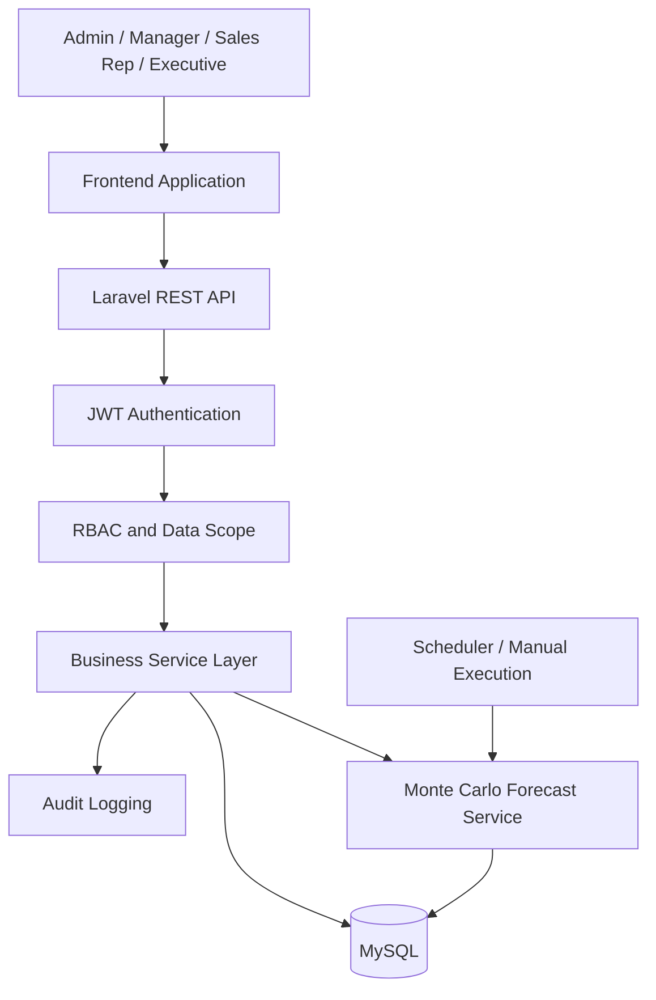

# System Architecture — ADI SalesTrack

## 1. Tujuan

Mendefinisikan arsitektur teknis ADI SalesTrack sebagai aplikasi sales tracking berbasis Laravel REST API, MySQL, dan frontend terpisah, dengan pendekatan hybrid terhadap aplikasi eksisting.

## 2. Keputusan Arsitektur

| Area | Keputusan |
|---|---|
| Pendekatan pengembangan | Hybrid: audit, pertahankan, refactor, dan extend |
| Backend | Laravel REST API |
| Database | MySQL |
| Frontend | Terpisah dari backend |
| Authentication | JWT |
| Authorization | RBAC + ownership/data scope |
| ORM | Eloquent |
| API versioning | `/api/v1` |
| Forecasting | Monte Carlo Simulation |
| Deployment | Menyesuaikan kemampuan hosting aktual |

Versi Laravel dan library JWT ditentukan setelah audit versi PHP, dependensi, dan implementasi aplikasi saat ini.

## 3. Logical Architecture



## 4. Tanggung Jawab Komponen

### Frontend
- Menampilkan dashboard, formulir, laporan, ranking, dan hasil forecast.
- Mengirim request ke REST API.
- Menangani status loading, error, dan validasi tampilan.
- Tidak menjadi sumber kebenaran untuk perhitungan revenue maupun otorisasi.

### Laravel API
- Menyediakan endpoint untuk semua modul.
- Memvalidasi request.
- Memeriksa JWT, role, dan cakupan data.
- Menjalankan aturan bisnis melalui service/action class.
- Mengembalikan response JSON yang konsisten.

### Database
- Menyimpan master data, aktivitas, transaksi, target, audit log, dan hasil forecast.
- Menjaga integritas data melalui foreign key, unique constraint, dan transaksi database.
- Menggunakan tipe `DECIMAL` untuk nilai uang.

### Forecast Service
- Mengambil data historis yang memenuhi aturan revenue.
- Menjalankan simulasi Monte Carlo.
- Menyimpan metadata eksekusi dan hasil.
- Memisahkan data aktual dari estimasi.

## 5. Struktur Backend yang Disarankan

Struktur berikut merupakan target dan harus disesuaikan dengan struktur repository eksisting.

```text
app/
├── Http/
│   ├── Controllers/Api/V1/
│   ├── Requests/
│   ├── Resources/
│   └── Middleware/
├── Models/
├── Policies/
├── Services/
│   ├── Revenue/
│   ├── Ranking/
│   └── Forecasting/
├── Actions/
├── Jobs/
└── Support/
```

Gunakan `Jobs/` hanya jika proses asynchronous benar-benar diperlukan dan didukung lingkungan deployment.

## 6. Alur Request API

1. Frontend mengirim request melalui HTTPS.
2. Middleware memvalidasi JWT untuk endpoint privat.
3. Authorization policy memeriksa role dan ownership.
4. Form Request memvalidasi input.
5. Service layer menjalankan aturan bisnis.
6. Eloquent mengakses database.
7. Perubahan penting dicatat ke audit log.
8. API mengembalikan response yang sesuai.

Operasi multi-tabel yang harus konsisten dijalankan dalam database transaction.

## 7. Strategi Hybrid

Setiap modul eksisting harus diklasifikasikan:

- Keep: dipertahankan.
- Fix: diperbaiki.
- Refactor: dirapikan tanpa mengubah aturan bisnis yang disetujui.
- Extend: dikembangkan.
- Replace: diganti jika memang diperlukan.

Sebelum perubahan database, lakukan backup, identifikasi dependensi, pemetaan data, dan pengujian regresi. Jangan mengganti semua tabel hanya untuk menyesuaikan ERD target.

## 8. Keamanan

- JWT memiliki masa berlaku yang jelas.
- Strategi refresh dan revocation harus didokumentasikan.
- Password disimpan menggunakan hashing yang sesuai.
- Otorisasi diterapkan pada backend.
- User tidak boleh memperoleh data privat dengan mengganti ID pada URL.
- Secret disimpan di environment server.
- Audit log tidak menyimpan password atau token lengkap.
- Endpoint laporan dan ekspor menerapkan pembatasan data yang sama dengan endpoint biasa.

## 9. Deployment

Sebelum menetapkan desain forecasting final, audit:
- Versi PHP dan ekstensi yang tersedia.
- Versi MySQL.
- Composer dan dependensi yang terpasang.
- Dukungan cron/scheduler.
- Dukungan queue worker atau proses background.
- Kapasitas database dan batas waktu request.

Jika worker tidak tersedia, jangan mengasumsikan job asynchronous dapat berjalan. Tentukan strategi eksekusi forecast berdasarkan hasil audit hosting.

## 10. Kriteria Penerimaan

- Semua modul dapat diakses melalui API yang konsisten.
- Perhitungan bisnis tidak bergantung pada frontend.
- Otorisasi mencakup role dan cakupan data.
- Perubahan penting dapat ditelusuri.
- Fitur lama yang dipertahankan lolos regression test.
- Forecast dapat dijalankan tanpa ketergantungan pada infrastruktur yang tidak tersedia.
