# ADI SalesTrack – Database Design & Specification

**Project:** ADI SalesTrack  
**Database:** MySQL  
**Backend:** Laravel REST API  
**Purpose:** Sales Management, Product Catalog, Opportunity Tracking, Revenue Forecasting  
**Version:** 1.0

---

# 1. Overview

Database ADI SalesTrack dirancang untuk mengelola aktivitas penjualan PT All Data International, termasuk pengelolaan principal, produk, spesifikasi teknis, harga lisensi, jasa implementasi, dan sales opportunity.

Database juga dirancang untuk mendukung implementasi algoritma Monte Carlo dalam memprediksi potensi pendapatan berdasarkan data historis penjualan dan opportunity.

## 1.1 Database Modules

| Module | Description |
|---|---|
| Principal Management | Pengelolaan principal/vendor |
| Product Management | Pengelolaan katalog produk |
| Product Specification | Pengelolaan spesifikasi teknis produk |
| Price List | Pengelolaan harga produk dan jasa |
| Opportunity Management | Pengelolaan peluang penjualan |
| Opportunity Items | Detail produk dan jasa dalam opportunity |
| Sales Activities | Pencatatan aktivitas sales |
| Monte Carlo Forecasting | Pengelolaan hasil prediksi pendapatan |

# 2. Entity Relationship Diagram (ERD)

```mermaid
erDiagram
    PRINCIPALS ||--o{ PRODUCTS : owns
    PRODUCT_CATEGORIES ||--o{ PRODUCTS : categorizes
    PRODUCTS ||--o{ PRODUCT_SPECIFICATIONS : has
    PRODUCTS ||--o{ PRICE_LISTS : priced_in

    OPPORTUNITIES ||--o{ OPPORTUNITY_ITEMS : contains
    PRODUCTS ||--o{ OPPORTUNITY_ITEMS : selected
    PRICE_LISTS ||--o{ OPPORTUNITY_ITEMS : references

    OPPORTUNITIES ||--o{ SALES_ACTIVITIES : has
    USERS ||--o{ OPPORTUNITIES : manages
    USERS ||--o{ SALES_ACTIVITIES : records

    USERS ||--o{ FORECAST_RUNS : executes
    FORECAST_RUNS ||--o{ FORECAST_RESULTS : generates
    OPPORTUNITIES ||--o{ FORECAST_RESULTS : contributes

    PRINCIPALS {
        bigint id PK
        string name
        string description
        boolean is_active
    }

    PRODUCTS {
        bigint id PK
        bigint principal_id FK
        bigint category_id FK
        string name
        string product_type
        text description
    }

    PRODUCT_SPECIFICATIONS {
        bigint id PK
        bigint product_id FK
        string specification_name
        string specification_value
        string unit
    }

    PRICE_LISTS {
        bigint id PK
        bigint product_id FK
        string pricing_type
        decimal unit_price
        string billing_period
        date effective_date
    }

    OPPORTUNITIES {
        bigint id PK
        bigint user_id FK
        string project_name
        string client_name
        decimal probability
        decimal estimated_value
        string status
        date closing_date
    }

    OPPORTUNITY_ITEMS {
        bigint id PK
        bigint opportunity_id FK
        bigint product_id FK
        bigint price_list_id FK
        decimal quantity
        decimal unit_price
        decimal subtotal
    }

    SALES_ACTIVITIES {
        bigint id PK
        bigint opportunity_id FK
        bigint user_id FK
        string activity_type
        text description
        date activity_date
    }

    FORECAST_RUNS {
        bigint id PK
        bigint user_id FK
        string forecast_period
        decimal predicted_revenue
        decimal actual_revenue
        decimal mape
    }

    FORECAST_RESULTS {
        bigint id PK
        bigint forecast_run_id FK
        bigint opportunity_id FK
        decimal simulated_value
        decimal probability
    }
```



# 3. Database Table Specifications

## 3.1 principals

Menyimpan informasi principal atau vendor yang menjadi mitra bisnis PT All Data International.

| Field | Type | Description |
|---|---|---|
| id | BIGINT | Primary Key |
| name | VARCHAR(150) | Nama principal |
| description | TEXT | Deskripsi principal |
| website | VARCHAR(255) | Website resmi |
| is_active | BOOLEAN | Status aktif |
| created_at | TIMESTAMP | Waktu dibuat |
| updated_at | TIMESTAMP | Waktu diperbarui |

Contoh data:

| ID | Principal |
|---|---|
| 1 | Qlik |
| 2 | Confluent |
| 3 | Denodo |
| 4 | Snowflake |
| 5 | Dataiku |
| 6 | Cloudera |
| 7 | Tableau |
| 8 | Hasura |
| 9 | ClickHouse |
| 10 | Alibaba Cloud |
| 11 | Redis |
| 12 | Dell |
| 13 | AWS |
| 14 | HPE |
| 15 | Huawei Cloud |
| 16 | Talend |

## 3.2 product_categories

Mengelompokkan produk berdasarkan jenis solusi.

| Field | Type | Description |
|---|---|---|
| id | BIGINT | Primary Key |
| name | VARCHAR(100) | Nama kategori |
| description | TEXT | Deskripsi kategori |
| created_at | TIMESTAMP | Waktu dibuat |
| updated_at | TIMESTAMP | Waktu diperbarui |

Contoh kategori:

- Data Analytics
- Data Integration
- Data Virtualization
- Cloud Computing
- Cloud Storage
- Cloud Database
- Server Infrastructure
- Networking
- AI & Machine Learning
- Data Management

## 3.3 products

Menyimpan katalog produk dan layanan dari masing-masing principal.

| Field | Type | Description |
|---|---|---|
| id | BIGINT | Primary Key |
| principal_id | BIGINT | Foreign Key ke principals |
| category_id | BIGINT | Foreign Key ke product_categories |
| name | VARCHAR(200) | Nama produk |
| product_type | ENUM | LICENSE, HARDWARE, CLOUD, SERVICE |
| description | TEXT | Deskripsi produk |
| unit | VARCHAR(50) | Satuan produk |
| is_active | BOOLEAN | Status produk |
| created_at | TIMESTAMP | Waktu dibuat |
| updated_at | TIMESTAMP | Waktu diperbarui |

Contoh data:

| Principal | Product | Type |
|---|---|---|
| AWS | EC2 Instance | CLOUD |
| AWS | S3 Storage | CLOUD |
| AWS | RDS Database | CLOUD |
| Alibaba Cloud | ECS Instance | CLOUD |
| Huawei Cloud | EVS Storage | CLOUD |
| Dell | PowerEdge Rack Server | HARDWARE |
| HPE | ProLiant Server | HARDWARE |
| Denodo | Denodo Platform | LICENSE |
| Tableau | Tableau Enterprise | LICENSE |
| Qlik | Qlik Sense | LICENSE |

## 3.4 product_specifications

Menyimpan spesifikasi teknis setiap produk.

Struktur dibuat dinamis agar dapat digunakan untuk berbagai jenis produk, seperti server, cloud, database, dan networking.

| Field | Type | Description |
|---|---|---|
| id | BIGINT | Primary Key |
| product_id | BIGINT | Foreign Key ke products |
| specification_name | VARCHAR(100) | Nama spesifikasi |
| specification_value | VARCHAR(255) | Nilai spesifikasi |
| unit | VARCHAR(50) | Satuan |
| created_at | TIMESTAMP | Waktu dibuat |
| updated_at | TIMESTAMP | Waktu diperbarui |

Contoh data:

| Product | Specification | Value | Unit |
|---|---|---:|---|
| AWS EC2 | vCPU | 4 | Core |
| AWS EC2 | RAM | 16 | GB |
| AWS EC2 | Instance | 1 | Unit |
| AWS EBS | Storage | 500 | GB |
| Dell Server | Processor | 32 | Core |
| Dell Server | RAM | 128 | GB |
| Dell Server | SSD | 1.92 | TB |
| Dell Server | Node | 3 | Unit |

## 3.5 price_lists

Menyimpan harga produk dan jasa berdasarkan satuan dan periode harga.

| Field | Type | Description |
|---|---|---|
| id | BIGINT | Primary Key |
| product_id | BIGINT | Foreign Key ke products |
| pricing_type | ENUM | LICENSE, SUBSCRIPTION, ONE_TIME, SERVICE |
| unit_price | DECIMAL(18,2) | Harga satuan |
| currency | VARCHAR(3) | Mata uang |
| billing_period | VARCHAR(30) | MONTHLY, YEARLY, ONE_TIME |
| effective_date | DATE | Tanggal mulai berlaku |
| expiry_date | DATE | Tanggal berakhir |
| is_active | BOOLEAN | Status harga |
| created_at | TIMESTAMP | Waktu dibuat |
| updated_at | TIMESTAMP | Waktu diperbarui |

Contoh data:

| Product | Pricing Type | Price | Period |
|---|---|---:|---|
| AWS EC2 4 vCPU | SUBSCRIPTION | Rp3.000.000 | MONTHLY |
| AWS EBS 500 GB | SUBSCRIPTION | Rp1.000.000 | MONTHLY |
| AWS S3 1 TB | SUBSCRIPTION | Rp350.000 | MONTHLY |
| Dell Server 2U | ONE_TIME | Rp60.000.000 | ONE_TIME |
| Denodo Platform | LICENSE | Rp600.000.000 | YEARLY |
| Server Installation | SERVICE | Rp15.000.000 | ONE_TIME |

Catatan: Harga merupakan data simulasi. Untuk implementasi produksi, harga dapat diperbarui tanpa mengubah data transaksi sebelumnya.

## 3.6 opportunities

Menyimpan informasi peluang penjualan yang dikelola oleh tim sales.

| Field | Type | Description |
|---|---|---|
| id | BIGINT | Primary Key |
| user_id | BIGINT | Sales Account Manager |
| project_name | VARCHAR(200) | Nama proyek |
| client_name | VARCHAR(200) | Nama perusahaan klien |
| principal_id | BIGINT | Principal utama, nullable |
| sa_pic | VARCHAR(150) | Solution Architect PIC |
| license_type | VARCHAR(50) | New, Renewal, Expansion |
| progress | VARCHAR(100) | Tahapan penjualan |
| probability | DECIMAL(5,2) | Peluang keberhasilan (%) |
| deal_registration | VARCHAR(100) | Nomor registrasi deal |
| estimated_value | DECIMAL(18,2) | Estimasi nilai opportunity |
| status | ENUM | OPEN, WON, LOST |
| closing_date | DATE | Target tanggal closing |
| actual_closing_date | DATE | Tanggal closing aktual |
| remarks | TEXT | Catatan opportunity |
| created_at | TIMESTAMP | Waktu dibuat |
| updated_at | TIMESTAMP | Waktu diperbarui |

Contoh tahapan penjualan:

| Progress | Probability |
|---|---:|
| Lead | 10% |
| Introduction | 20% |
| Discovery | 30% |
| Presentation | 40% |
| Proposal | 60% |
| Negotiation | 80% |
| Closing | 90% |
| Won | 100% |
| Lost | 0% |

Probability di atas merupakan contoh konfigurasi awal dan dapat disesuaikan berdasarkan kebijakan perusahaan.

## 3.7 opportunity_items

Menyimpan rincian setiap produk atau jasa dalam satu opportunity.

Satu opportunity dapat memiliki banyak item produk, sehingga dapat mencakup license, hardware, cloud, dan service sekaligus.

| Field | Type | Description |
|---|---|---|
| id | BIGINT | Primary Key |
| opportunity_id | BIGINT | Foreign Key ke opportunities |
| product_id | BIGINT | Foreign Key ke products |
| price_list_id | BIGINT | Referensi harga, nullable |
| item_description | VARCHAR(255) | Deskripsi item |
| quantity | DECIMAL(12,2) | Jumlah |
| unit_price | DECIMAL(18,2) | Harga satuan saat transaksi |
| subtotal | DECIMAL(18,2) | Total harga |
| created_at | TIMESTAMP | Waktu dibuat |
| updated_at | TIMESTAMP | Waktu diperbarui |

Formula:

```text
Subtotal = Quantity × Unit Price

Estimated Opportunity Value =
SUM(All Opportunity Item Subtotals)
```

Contoh:

| Product | Qty | Unit Price | Subtotal |
|---|---:|---:|---:|
| Dell Server 2U | 3 | 60.000.000 | 180.000.000 |
| RAM 128 GB | 3 | 18.000.000 | 54.000.000 |
| SSD 1.92 TB | 6 | 9.000.000 | 54.000.000 |
| Server Installation | 1 | 15.000.000 | 15.000.000 |

Total Opportunity: Rp303.000.000.

Harga pada opportunity_items harus disimpan sebagai snapshot agar perubahan price list tidak mengubah transaksi yang sudah tercatat.

## 3.8 sales_activities

Mencatat seluruh aktivitas sales terhadap opportunity.

| Field | Type | Description |
|---|---|---|
| id | BIGINT | Primary Key |
| opportunity_id | BIGINT | Foreign Key ke opportunities |
| user_id | BIGINT | Sales yang melakukan aktivitas |
| activity_type | VARCHAR(100) | Jenis aktivitas |
| description | TEXT | Deskripsi aktivitas |
| activity_date | DATETIME | Tanggal aktivitas |
| created_at | TIMESTAMP | Waktu dibuat |
| updated_at | TIMESTAMP | Waktu diperbarui |

Contoh aktivitas:

- Customer Meeting
- Product Presentation
- Technical Discussion
- Proposal Submission
- Follow Up
- Negotiation
- Closing

# 4. Monte Carlo Forecasting Tables

Modul ini digunakan untuk menyimpan proses dan hasil simulasi Monte Carlo.

## 4.1 forecast_runs

Menyimpan informasi setiap proses prediksi pendapatan.

| Field | Type | Description |
|---|---|---|
| id | BIGINT | Primary Key |
| user_id | BIGINT | Manager yang menjalankan prediksi |
| forecast_name | VARCHAR(150) | Nama prediksi |
| start_period | DATE | Awal periode |
| end_period | DATE | Akhir periode |
| simulation_count | INT | Jumlah iterasi simulasi |
| predicted_revenue | DECIMAL(18,2) | Hasil prediksi |
| best_case | DECIMAL(18,2) | Skenario terbaik |
| worst_case | DECIMAL(18,2) | Skenario terburuk |
| most_likely | DECIMAL(18,2) | Skenario paling mungkin |
| actual_revenue | DECIMAL(18,2) | Pendapatan aktual |
| mape | DECIMAL(8,4) | Tingkat kesalahan prediksi |
| created_at | TIMESTAMP | Waktu prediksi |

## 4.2 forecast_results

Menyimpan kontribusi opportunity pada setiap proses simulasi.

| Field | Type | Description |
|---|---|---|
| id | BIGINT | Primary Key |
| forecast_run_id | BIGINT | Foreign Key ke forecast_runs |
| opportunity_id | BIGINT | Foreign Key ke opportunities |
| simulated_value | DECIMAL(18,2) | Nilai hasil simulasi |
| probability | DECIMAL(5,2) | Probabilitas opportunity |
| simulation_iteration | INT | Nomor iterasi |
| created_at | TIMESTAMP | Waktu dibuat |

Catatan: Jika hasil setiap iterasi disimpan, jumlah record dapat menjadi sangat besar. Implementasi dapat menyimpan hasil agregat atau hasil detail sesuai kebutuhan penelitian.

# 5. Database Relationships

Relasi antar tabel:

| Parent Table | Child Table | Relationship |
|---|---|---|
| principals | products | One to Many |
| product_categories | products | One to Many |
| products | product_specifications | One to Many |
| products | price_lists | One to Many |
| opportunities | opportunity_items | One to Many |
| products | opportunity_items | One to Many |
| opportunities | sales_activities | One to Many |
| users | opportunities | One to Many |
| users | sales_activities | One to Many |
| forecast_runs | forecast_results | One to Many |
| opportunities | forecast_results | One to Many |

# 6. Business Rules

## 6.1 Product Management

1. Setiap produk harus terhubung dengan satu principal.
2. Produk dapat memiliki banyak spesifikasi.
3. Produk dapat memiliki beberapa versi harga.
4. Harga produk dapat berubah tanpa mengubah histori opportunity.
5. Produk dapat dikategorikan sebagai License, Hardware, Cloud, atau Service.

## 6.2 Opportunity Management

1. Satu opportunity dapat memiliki banyak produk dan jasa.
2. Nilai opportunity dihitung berdasarkan total seluruh item.
3. Setiap opportunity memiliki probability keberhasilan.
4. Status opportunity terdiri dari OPEN, WON, dan LOST.
5. Opportunity WON menyimpan nilai pendapatan aktual.
6. Opportunity LOST tidak dihitung sebagai pendapatan aktual.
7. Perubahan probability harus tercatat dalam histori apabila diperlukan untuk evaluasi.

## 6.3 Revenue Calculation

```text
Total License =
SUM(Subtotal item dengan product_type LICENSE)

Total Hardware =
SUM(Subtotal item dengan product_type HARDWARE)

Total Cloud =
SUM(Subtotal item dengan product_type CLOUD)

Total Service =
SUM(Subtotal item dengan product_type SERVICE)

Total Opportunity =
License + Hardware + Cloud + Service
```

# 7. Monte Carlo Calculation

Monte Carlo digunakan untuk memprediksi potensi pendapatan berdasarkan distribusi probabilitas dari data historis.

## 7.1 Input Variables

| Variable | Description |
|---|---|
| Historical Revenue | Data pendapatan historis |
| Opportunity Value | Estimasi nilai opportunity |
| Probability | Probabilitas keberhasilan |
| Opportunity Status | Status peluang penjualan |
| Forecast Period | Periode prediksi |
| Simulation Count | Jumlah iterasi simulasi |

## 7.2 Expected Revenue

Rumus dasar nilai ekspektasi opportunity:

```text
Expected Revenue = Opportunity Value × Probability
```

Contoh:

```text
Opportunity Value = Rp500.000.000
Probability = 60%

Expected Revenue =
Rp500.000.000 × 60%

Expected Revenue = Rp300.000.000
```

Rumus tersebut merupakan nilai ekspektasi, bukan hasil akhir simulasi Monte Carlo.

## 7.3 Forecast Evaluation

Prediksi dievaluasi dengan Mean Absolute Percentage Error (MAPE):

```text
MAPE = (1/n) × Σ |(Actual - Forecast) / Actual| × 100%
```

Evaluasi dilakukan dengan membandingkan hasil prediksi dan pendapatan aktual pada periode yang sama.

# 8. Recommended Laravel Migration Structure

Urutan pembuatan migration:

```text
database/migrations/

01_create_principals_table.php
02_create_product_categories_table.php
03_create_products_table.php
04_create_product_specifications_table.php
05_create_price_lists_table.php
06_create_opportunities_table.php
07_create_opportunity_items_table.php
08_create_sales_activities_table.php
09_create_forecast_runs_table.php
10_create_forecast_results_table.php
```

Catatan:
- Tabel `users` menggunakan tabel autentikasi Laravel yang sudah tersedia.
- Migration harus dibuat berdasarkan foreign key dependency.
- Gunakan `decimal(18,2)` untuk menyimpan nilai transaksi.
- Gunakan foreign key dan index untuk kolom relasi.
- Gunakan soft delete apabila diperlukan untuk master data.
- Gunakan transaksi database ketika menyimpan opportunity beserta item-itemnya.

# 9. Recommended API Endpoints

| Method | Endpoint | Description |
|---|---|---|
| GET | /api/principals | List principal |
| POST | /api/principals | Create principal |
| GET | /api/products | List products |
| POST | /api/products | Create product |
| GET | /api/products/{id}/specifications | Product specifications |
| POST | /api/products/{id}/specifications | Add specification |
| GET | /api/price-lists | List prices |
| POST | /api/price-lists | Create price |
| GET | /api/opportunities | List opportunities |
| POST | /api/opportunities | Create opportunity |
| GET | /api/opportunities/{id} | Opportunity detail |
| POST | /api/opportunities/{id}/items | Add opportunity item |
| POST | /api/opportunities/{id}/activities | Add sales activity |
| GET | /api/forecasting | Forecast history |
| POST | /api/forecasting/run | Run Monte Carlo simulation |
| GET | /api/forecasting/{id} | Forecast detail |

# 10. Final Database Design Objectives

Database ini dirancang untuk memenuhi kebutuhan berikut:

1. Mengelola principal dan katalog produk PT All Data International.
2. Menyimpan spesifikasi teknis produk, khususnya server dan cloud.
3. Mengelola harga lisensi, hardware, cloud, dan jasa implementasi.
4. Menyimpan rincian transaksi berdasarkan item produk.
5. Mengelola sales opportunity dan aktivitas tim sales.
6. Menghitung total nilai opportunity secara otomatis.
7. Menyediakan data historis untuk algoritma Monte Carlo.
8. Menyimpan hasil prediksi dan evaluasi akurasi menggunakan MAPE.

**End of Database Design Specification**